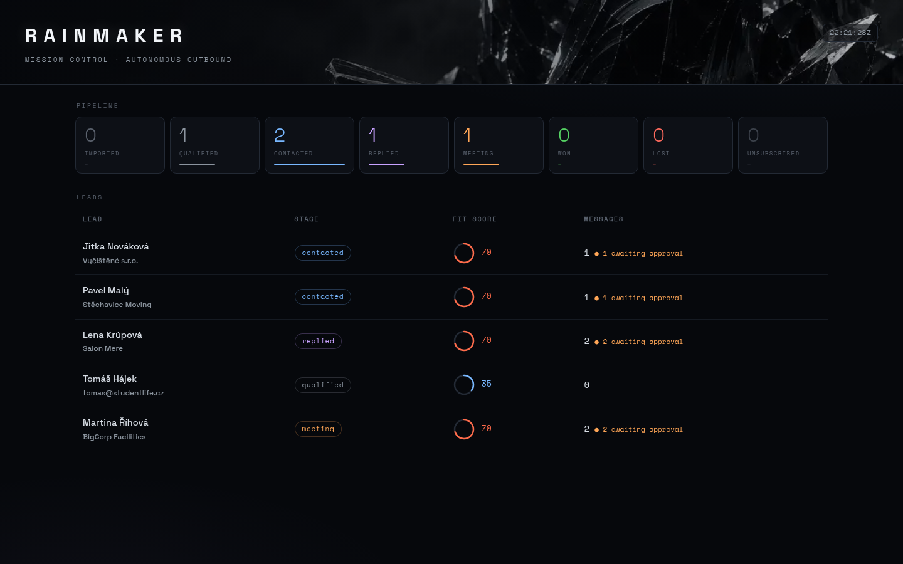

# rainmaker

**The open-source AI salesman.** Plug in your offer and a list of leads — rainmaker qualifies them against your ideal customer profile, writes personalized outreach in your voice, follows up on a cadence, routes replies by intent and hands you meetings.

```
leads.csv ──▶ qualify ──▶ first touch ──▶ follow-up cadence ──▶ reply routing ──▶ booked call
              (0–100        in your        48h / 96h / 168h     interested?        calendar link
              vs. ICP)      voice                             question? opt-out?   in your inbox
```

[](https://github.com/LiveFuller/rainmaker/actions/workflows/ci.yml)
[](LICENSE)

[](#how-it-thinks)



## Why

Every small business dies or lives on outbound. The existing options are either \$100+/month black-box SaaS or glue-your-own scripts. rainmaker is the middle ground: a real codebase you can read end-to-end, self-host, bend to your niche — and point at a revenue problem the same afternoon.

## Try it in one minute — no keys, no network

```sh
git clone https://github.com/LiveFuller/rainmaker
cd rainmaker
npm install
npm run demo
```

Demo mode runs the entire loop offline against five sample Czech service-business leads:

```
=== Pipeline ===
  contacted    4
  qualified    1

=== Leads ===
  Jitka Nováková         contacted  score  70 (hot)  — Senior buyer matching the ideal profile
  Pavel Malý             contacted  score  70 (hot)  — Senior buyer matching the ideal profile
  Lena Krúpová           contacted  score  70 (hot)  — Senior buyer matching the ideal profile
  Tomáš Hájek            qualified  score  35 (cold) — Little overlap with the ideal profile
  Martina Říhová         contacted  score  70 (hot)  — Senior buyer matching the ideal profile

=== Sample first touch ===
To: jitka@vycistene.cz
Subject: quick question for Vyčištěné s.r.o.

Hi Jitka Nováková,

Noticed Vyčištěné s.r.o. and figured this might land: SiteSpot Websites is built
exactly for teams like yours.

Open to a quick look? Happy to keep it to ten minutes.
```

The demo brain is deterministic and offline. Swap in a real LLM and the same pipeline runs live.

## The machine

`rainmaker agent` is the always-on daemon:

```sh
rainmaker agent --demo      # scripted brain, zero keys — full machine on :3000
rainmaker agent             # live: real LLM, real transport
```

What you get:

- **Mission control** at `http://localhost:3000` — live funnel, per-lead scores and reasoning, full message threads, one-click **approve & queue** for every draft.
- **Inbound webhook** at `POST /inbound` — point your email provider's inbound parsing at it. Replies are classified (interested / question / opt-out / out-of-office) and routed: interested leads jump straight to `meeting` with a calendar reply drafted, questions get answered from your offer facts, opt-outs become untouchable.
- **The tick loop** — every 15 minutes it qualifies new leads, sends approved mail inside your daily limit, and writes follow-ups exactly when their cadence interval expires. `48h → 96h → 168h` by default.
- **An MCP server** — `rainmaker mcp` exposes `qualify_lead`, `draft_outreach`, `classify_reply` and `pipeline_status` as tools over stdio, so Claude Code, Cursor or any MCP host can drive the pipeline directly.

## Go live

Copy <sub>`rainmaker.config.example.json`</sub> to `rainmaker.config.json` and fill in your offer. The example is pre-wired for Gmail/Workspace: SMTP out, IMAP in — you'll need an [app password](https://myaccount.google.com/apppasswords).

```sh
export OPENAI_API_KEY=…
export GMAIL_APP_PASSWORD=…
rainmaker agent        # daemon: dashboard, webhook, inbox listener, tick loop
```

Any OpenAI-compatible endpoint works — point `baseUrl` at a local model and the whole thing runs self-contained. Prefer API-based sending? `transport.kind` also accepts `"resend"` (HTTPS API) or `"outbox"` (writes `.eml` files, zero risk).

Once running, inbound replies need no wiring at all: the IMAP listener polls your mailbox, classifies what lands, drafts the answers. The `/inbound` webhook stays available for providers with native inbound parsing.

`leads.csv` needs only an `email` column; `name`, `company`, `role`, `website` and `notes` are picked up automatically under common aliases.

## How it thinks

| Stage | File | Job |
| :--- | :--- | :--- |
| Ingest | <sub>`src/ingest/csv.ts`</sub> | CSV → typed leads, quoted-field safe |
| Qualify | <sub>`src/qualify/scorer.ts`</sub> | LLM scores each lead 0–100 against your ICP, in writing |
| Write | <sub>`src/outreach/sequence.ts`</sub> | First touch ≤ 80 words, one idea, one question; follow-ups get shorter |
| Route | <sub>`src/reply/classifier.ts`</sub> | Replies classified: interested / question / opt-out / OOO |
| Answer | <sub>`src/reply/responder.ts`</sub> | Drafts replies — answers questions from offer facts, proposes the calendar |
| Run | <sub>`src/agent/runner.ts`</sub> | The tick loop: cadence scheduling, daily send limits, autopilot or approval |
| Serve | <sub>`src/server/http.ts` + `dashboard.ts`</sub> | Mission control UI, inbound webhook, approvals — zero dependencies |
| Speak MCP | <sub>`src/mcp/server.ts`</sub> | stdio JSON-RPC: initialize, tools/list, tools/call |
| Send | <sub>`src/outreach/sender.ts`</sub> | Dev outbox (.eml files) or live Resend transport |
| Pipeline | <sub>`src/core/pipeline.ts`</sub> | State machine — no illegal jumps, every move timestamped |
| Memory | <sub>`src/core/store.ts`</sub> | Flat JSON under `.rainmaker/`, zero database required |

Two hard rules baked in:

1. **`approval` mode is the default.** Nothing sends without a human yes. `autopilot` exists, but it's opt-in.
2. **`unsubscribed` is terminal.** A lead that opts out can never be touched again — the state machine makes it impossible, not just unlikely.

## Roadmap

- [x] Mission-control dashboard — live pipeline web UI
- [x] Inbound webhook — replies classified and routed automatically
- [x] MCP server — qualify / draft / classify / pipeline tools for any agent host
- [x] Sending adapters — hand-rolled SMTP (TLS/STARTTLS), Resend API, zero-config file outbox
- [x] Inbox listener — hand-rolled IMAP polling; replies route themselves
- [ ] Calendar booking — write events directly, not just offer the link
- [ ] Enrichment adapters — pull public company data before scoring
- [ ] Voice follow-ups — escalate hot threads to an AI phone call
- [ ] Multi-offer workspaces — several products, one dashboard

## Contributing

Issues and PRs welcome. The test suite is `node:test` only — no framework, `npm test` and you're running.

## License

[MIT](LICENSE) — use it to make money. That's the point.
